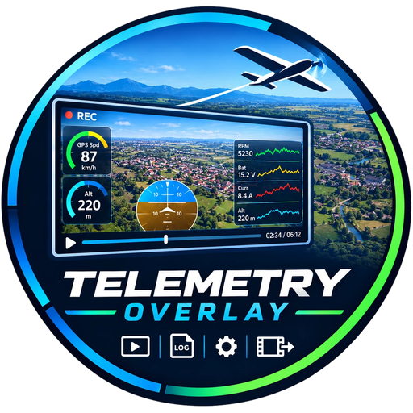
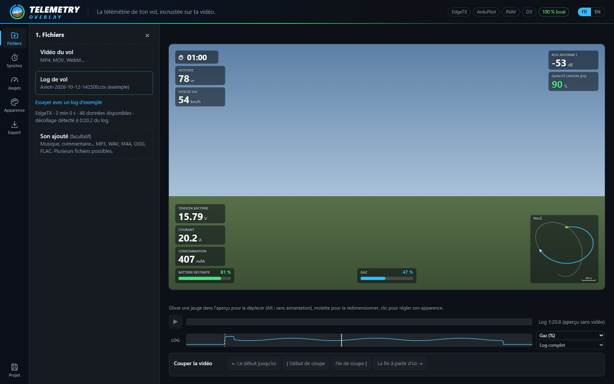
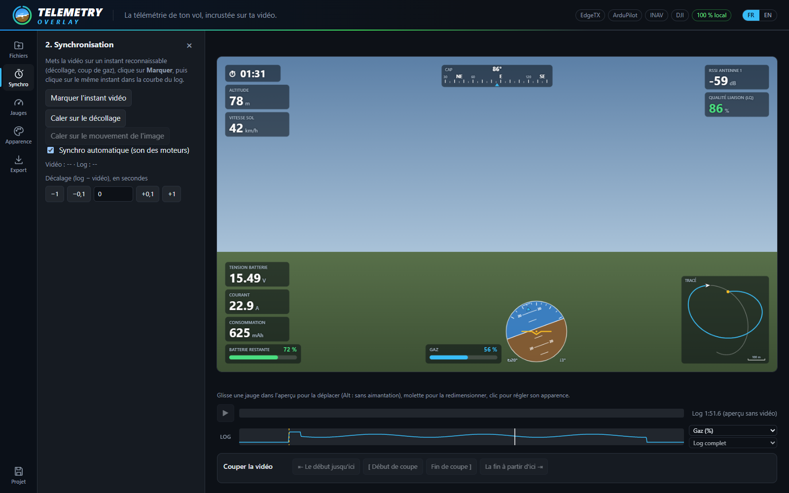
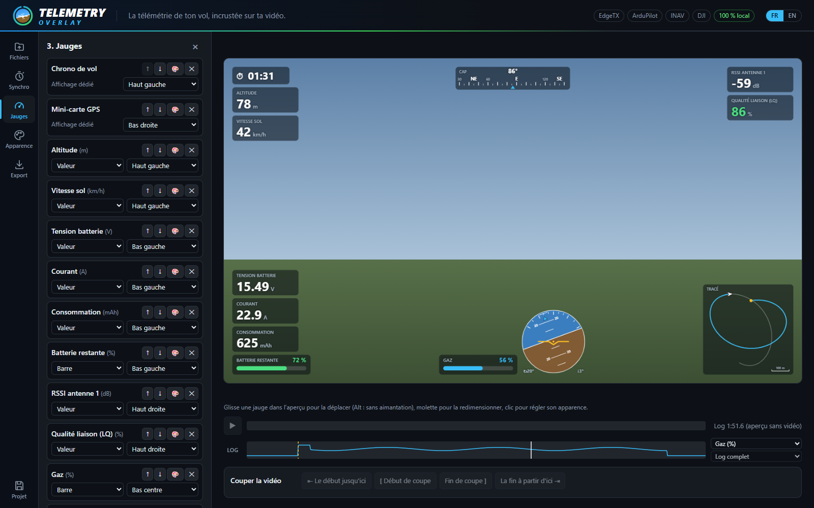
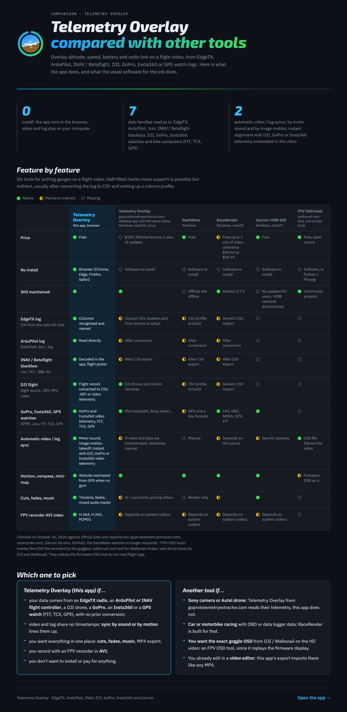
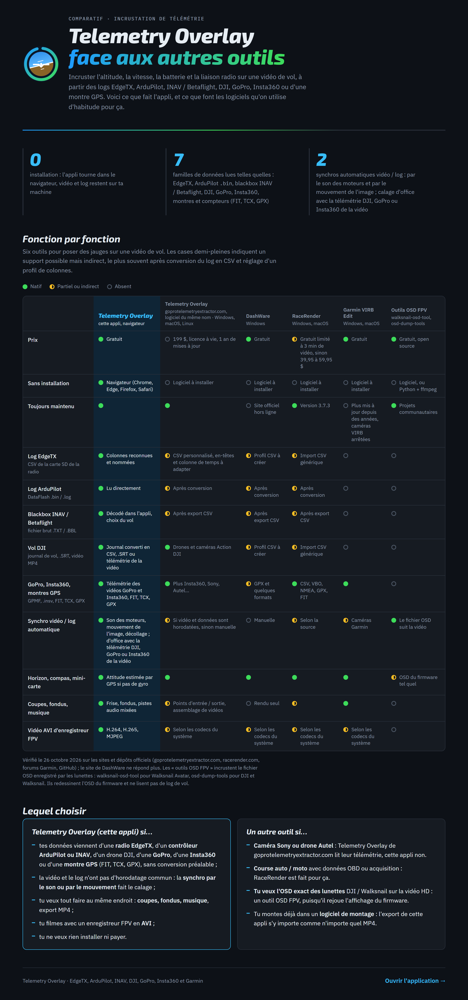

# Telemetry Overlay

**[English](#english) · [Français](#français)**

👉 **[Open the app / Ouvrir l'application](https://tguillaume02.github.io/telemetry-overlay/)**

  
  

## English

*For EdgeTX, ArduPilot, INAV, DJI, GoPro, Insta360 and Garmin.*

Overlays the telemetry of your flight or ride (altitude, speed, battery, radio link, throttle, GPS track, heart rate) from an EdgeTX radio log, an ArduPilot / INAV flight controller, a DJI drone, a GoPro or Insta360 camera, or a GPS watch / bike computer (FIT, TCX, GPX) onto your videos, right in the browser. The video and the log never leave your computer.

### Comparison

### Slow export, graphics card at 0%?

On a laptop, Windows often runs the browser on the integrated graphics chip (Intel / AMD), and the dedicated graphics card (NVIDIA / AMD) stays at 0% during the export. To hand the browser over to it:

1. **Windows Settings › System › Display › Graphics**;
2. pick the browser (Chrome or Edge; add it with *Browse* if it is not listed) and set it to **High performance**;
3. close and restart the browser.

Also keep the PC plugged in: on battery, Windows throttles the browser (efficiency mode, green leaf icon in the Task Manager).

This repository only contains the published site; it is updated automatically.

## Français

*Pour EdgeTX, ArduPilot, INAV, DJI, GoPro, Insta360 et Garmin.*

Incruste la télémétrie de ton vol ou de ta sortie (altitude, vitesse, batterie, liaison radio, gaz, trace GPS, fréquence cardiaque), issue d'un log de radio EdgeTX, de contrôleur ArduPilot / INAV, de drone DJI, de caméra GoPro ou Insta360, ou de montre / compteur GPS (FIT, TCX, GPX), sur tes vidéos, directement dans le navigateur. La vidéo et le log ne quittent pas ta machine.

### Comparatif

### Export lent, carte graphique à 0 % ?

Sur un PC portable, Windows fait souvent tourner le navigateur sur la puce graphique intégrée (Intel / AMD), et la carte graphique dédiée (NVIDIA / AMD) reste à 0 % pendant l'export. Pour la confier au navigateur :

1. **Paramètres Windows › Système › Affichage › Graphiques** ;
2. choisir le navigateur (Chrome ou Edge ; l'ajouter avec *Parcourir* s'il n'est pas dans la liste) et le régler sur **Hautes performances** ;
3. fermer et relancer le navigateur.

Garder aussi le PC branché sur secteur : sur batterie, Windows bride le navigateur (mode efficacité, icône de feuille verte dans le Gestionnaire des tâches).

Ce dépôt contient uniquement le site publié ; il est mis à jour automatiquement.

---

☕ Useful project? [Buy me a coffee](https://ko-fi.com/thibaultguillaume) (card or PayPal, no account needed). · Ce projet vous est utile ? [Offrez-moi un café](https://ko-fi.com/thibaultguillaume) (carte bancaire ou PayPal, sans créer de compte).

🔗 My other projects / Mes autres projets : [tguillaume02.github.io](https://tguillaume02.github.io/)
